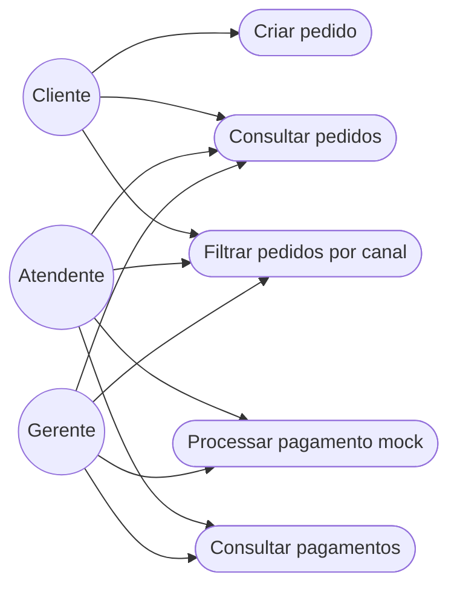
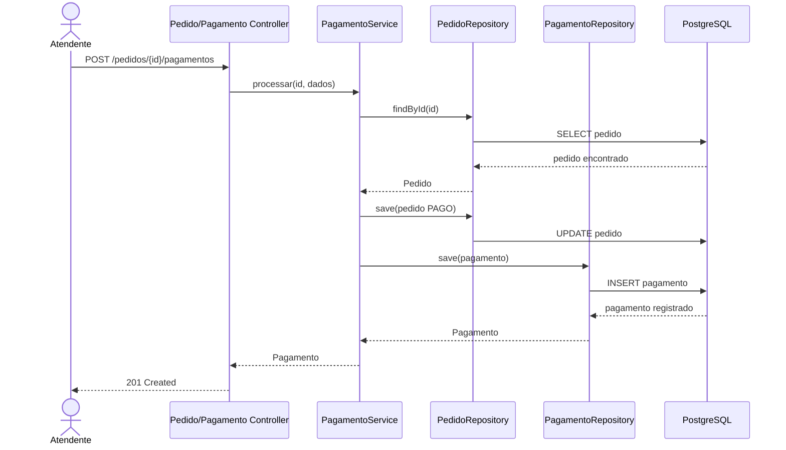
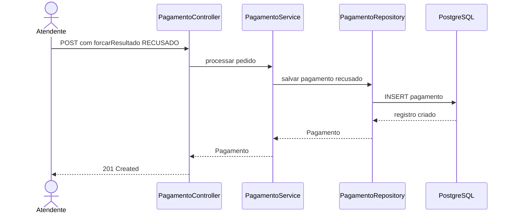
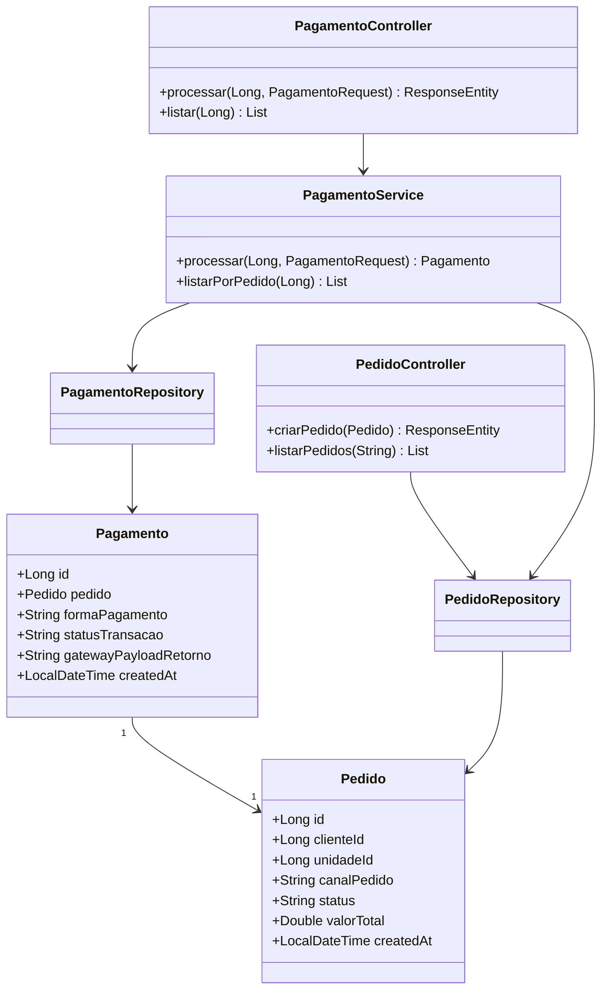
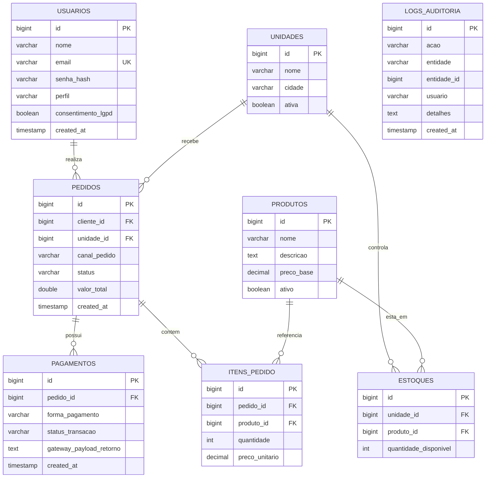

# Diagramas do Sistema

## Diagrama de casos de uso

## Diagrama de sequência: pagamento aprovado

## Diagrama de sequência: pagamento recusado

O pedido permanece em `AGUARDANDO_PAGAMENTO` quando o resultado do mock é recusado.

## Diagrama de classes

## Diagrama entidade-relacionamento simplificado

